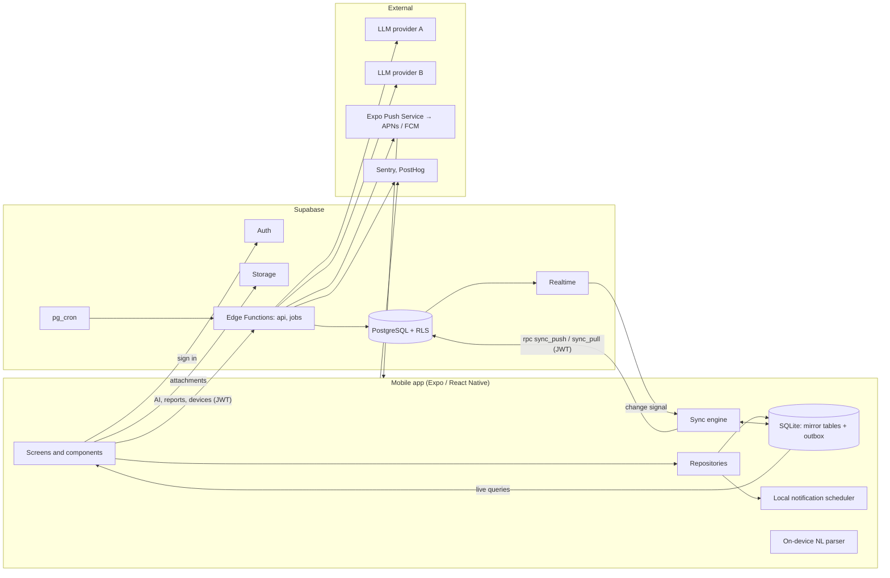

# 4. Architecture

## 4.1 System overview



Three planes, kept separate:

| Plane         | Path                                                                                                        | Works offline |
| ------------- | ----------------------------------------------------------------------------------------------------------- | ------------- |
| Data          | UI → repository → SQLite → outbox → `sync_push` / `sync_pull`                                               | Yes           |
| AI            | UI → `api` Edge Function → AI gateway → provider; changes come back as proposals applied via the data plane | No            |
| Notifications | Local scheduler on device; server push for server-originated events                                         | Reminders yes |

## 4.2 Technology decisions

### Mobile framework — React Native + Expo + TypeScript

| Option                           | Assessment                                                                                                                                                                                                                                                                                                                                     |
| -------------------------------- | ---------------------------------------------------------------------------------------------------------------------------------------------------------------------------------------------------------------------------------------------------------------------------------------------------------------------------------------------- |
| **Expo (chosen)**                | TypeScript end to end, so Zod contracts are shared between app and Edge Functions; file-based routing with deep links (Expo Router); managed native builds and over-the-air JS updates (EAS); mature gesture/animation stack (Reanimated, Gesture Handler) that runs on the UI thread, which is what swipe rows, sheets and drag-and-drop need |
| Flutter                          | Excellent rendering consistency and performance. Rejected because it would split the codebase into Dart + TypeScript with no shared contract types, and this project's server logic is TypeScript                                                                                                                                              |
| Kotlin Multiplatform / native ×2 | Best platform fidelity, roughly double the UI work. Not justified for this product                                                                                                                                                                                                                                                             |

### Backend — Supabase

| Option                    | Assessment                                                                                                                                                                                                                                                                                                                                                                                         |
| ------------------------- | -------------------------------------------------------------------------------------------------------------------------------------------------------------------------------------------------------------------------------------------------------------------------------------------------------------------------------------------------------------------------------------------------- |
| **Supabase (chosen)**     | The app's backend needs are: Postgres, auth, per-user row isolation, file storage, a change signal, scheduled jobs, and a place to run server code with secrets. Supabase provides each as a managed piece on top of plain Postgres. RLS enforces isolation in the database itself, so a bug in app code cannot leak another user's rows. Edge Functions are TypeScript, sharing `packages/shared` |
| Custom FastAPI + Postgres | Full control and a stronger Python AI ecosystem. Rejected for R1: it means building and operating auth, token refresh, storage, realtime, job scheduling and deployment — none of which differentiates this product — and it adds a second language without shared types. The AI gateway here is orchestration over HTTP APIs, which does not need Python                                          |
| Firebase                  | Good offline SDK, but a document store; this domain is relational (projects, sections, tags, goals, analytics queries) and the brief requires PostgreSQL                                                                                                                                                                                                                                           |

Exit path: all server logic is either SQL (portable) or framework-light TypeScript behind interfaces, so
the AI gateway and jobs can move to a standalone service later without touching the app's contracts.

### Offline sync — custom patch-based outbox

| Option                                    | Assessment                                                                                                                                                                                                                                                                                                                                                                                                   |
| ----------------------------------------- | ------------------------------------------------------------------------------------------------------------------------------------------------------------------------------------------------------------------------------------------------------------------------------------------------------------------------------------------------------------------------------------------------------------ |
| **Custom outbox + pull cursors (chosen)** | The data is single-user, so conflicts only arise between one person's own devices. That makes a simple, explainable rule set sufficient (§4.5). It needs no extra service and stays fully testable. Cost: we own the correctness, so it has the heaviest test coverage in the project                                                                                                                        |
| PowerSync (or similar sync service)       | Purpose-built Postgres ↔ SQLite sync that integrates with Supabase. A legitimate alternative that removes most sync code, at the cost of another hosted dependency and its pricing. **Fallback plan:** the sync engine sits behind `SyncEngine` (§4.5); if the custom engine proves unreliable in Phase 3 testing, swap the implementation. Its current API and pricing were not reviewed for this blueprint |
| Supabase client with a query cache only   | Not offline-first: writes fail offline. Rejected                                                                                                                                                                                                                                                                                                                                                             |
| CRDTs                                     | Solves concurrent multi-user editing, which this product does not have. Over-engineering                                                                                                                                                                                                                                                                                                                     |

### Other choices

| Concern                          | Choice                                                                                                                                         | Why                                                                                                        |
| -------------------------------- | ---------------------------------------------------------------------------------------------------------------------------------------------- | ---------------------------------------------------------------------------------------------------------- |
| Local DB                         | `expo-sqlite` + Drizzle ORM                                                                                                                    | Typed schema and queries, bundled migrations, reactive live queries                                        |
| Server state (network-only data) | TanStack Query                                                                                                                                 | Caching, retries, cancellation for AI endpoints, reports, notifications                                    |
| UI state                         | Zustand                                                                                                                                        | Small stores for ephemeral state (bulk selection, sheet state, drafts). No global app store                |
| Key-value                        | `react-native-mmkv` (non-secret), `expo-secure-store` (secrets)                                                                                | Synchronous reads for theme and flags; Keychain/Keystore for tokens                                        |
| Styling                          | Own token theme + `StyleSheet`                                                                                                                 | The design system is small and specific. Avoids a styling dependency and its build tooling                 |
| Lists                            | `@shopify/flash-list`                                                                                                                          | Recycling for long task lists                                                                              |
| Sheets                           | `@gorhom/bottom-sheet`                                                                                                                         | Keyboard-aware, gesture-driven sheets                                                                      |
| Drag and drop                    | Reanimated + Gesture Handler (own `Sortable`), or `react-native-reanimated-dnd`/`react-native-draggable-flatlist` if one fits after evaluation | Board drag across columns needs custom control; decide in Phase 2 with a spike                             |
| Charts                           | `victory-native` (Skia)                                                                                                                        | Performant, customisable to the tokens. Evaluate against `react-native-gifted-charts` in Phase 8; pick one |
| Dates                            | `date-fns` + `date-fns-tz`; `rrule` for recurrence; `chrono-node` for NL dates                                                                 | Small, tree-shakeable, well-established                                                                    |
| Ordering                         | `fractional-indexing`                                                                                                                          | Insert between two items without renumbering — one-row mutations that merge cleanly                        |
| Validation / contracts           | Zod in `packages/shared`                                                                                                                       | One schema for forms, API, AI output                                                                       |
| Forms                            | `react-hook-form` + Zod resolver                                                                                                               | Only for the larger forms                                                                                  |
| Speech                           | On-device recognition via `expo-speech-recognition`; fallback: record audio and transcribe server-side                                         | On-device is instant, free and private                                                                     |
| Push                             | `expo-notifications` + Expo Push Service                                                                                                       | One API for APNs and FCM                                                                                   |
| Errors / analytics               | Sentry (`@sentry/react-native`), PostHog                                                                                                       | Crash + performance tracing; product analytics and feature flags                                           |
| Purchases (R2)                   | RevenueCat                                                                                                                                     | Cross-store subscription state and webhooks                                                                |
| LLM access                       | Thin own `LLMProvider` interface with adapters over official provider SDKs (§ doc 07)                                                          | Provider independence without coupling the design to one abstraction library                               |
| Edge router                      | Hono inside one `api` function                                                                                                                 | Routing, middleware, versioned paths                                                                       |
| Monorepo                         | pnpm workspaces                                                                                                                                | Shared package with no publish step                                                                        |
| E2E                              | Maestro                                                                                                                                        | Simple YAML flows, runs on both platforms                                                                  |

## 4.3 Repository layout

```
/
├─ CLAUDE.md
├─ docs/
├─ package.json  pnpm-workspace.yaml  tsconfig.base.json  .github/workflows/
├─ packages/
│  ├─ shared/                      # no React, no Node/Deno-specific APIs
│  │  └─ src/
│  │     ├─ schemas/               # Zod: task.ts, project.ts, habit.ts, goal.ts, filter.ts …
│  │     ├─ api/                   # request/response schemas per endpoint, error codes
│  │     ├─ ai/                    # proposal operations, tool I/O schemas, capability ids
│  │     ├─ sync/                  # mutation + pull payload schemas, table registry
│  │     └─ domain/                # pure logic: recurrence, streaks, goal progress, today rules, due labels
│  └─ mobile/
│     ├─ app/                      # Expo Router routes only; thin, compose features
│     ├─ src/
│     │  ├─ design/                # tokens, ThemeProvider, useTheme, icons
│     │  ├─ components/ui/         # primitives (doc 02 §2.6)
│     │  ├─ components/domain/     # TaskRow, HabitCard, pickers …
│     │  ├─ features/              # one folder per module
│     │  │  ├─ auth/  onboarding/  tasks/  quick-add/  projects/  board/  calendar/
│     │  │  ├─ search/  habits/  goals/  analytics/  assistant/  ai-planner/  ai-breakdown/
│     │  │  ├─ ai-schedule/  ai-proposals/  notifications/  settings/
│     │  │  └─ <feature>/{screens,components,hooks,store.ts}
│     │  ├─ data/
│     │  │  ├─ db/                 # Drizzle schema, migrations, open/close per user
│     │  │  ├─ repositories/       # the only code that mutates SQLite
│     │  │  ├─ queries/            # live-query hooks (useTodayTasks, useProject …)
│     │  │  └─ sync/               # SyncEngine, outbox, pull apply, triggers
│     │  ├─ services/              # supabase client, api client, notifications, speech, attachments, analytics, haptics
│     │  ├─ nlp/                   # on-device quick-add parser
│     │  └─ lib/                   # small utilities, logger, env
│     ├─ e2e/                      # Maestro flows
│     └─ app.config.ts  eas.json
└─ supabase/
   ├─ migrations/                  # SQL, timestamped
   ├─ tests/                       # pgTAP
   ├─ seed.sql
   └─ functions/
      ├─ api/                      # index.ts (Hono), routes/v1/*, middleware/*
      ├─ jobs/                     # cron-invoked handlers
      └─ _shared/
         ├─ ai/                    # gateway, providers/, capabilities/, tools/, prompts/, validation
         ├─ db.ts  auth.ts  errors.ts  ratelimit.ts  push.ts  logger.ts
```

Dependency rules (enforce with ESLint `no-restricted-imports`):
`app/` → `features/` → `components/`, `data/queries`, `data/repositories`, `services/` → `shared`.
Features do not import other features' internals; shared pieces move to `components/domain` or `shared/domain`.
Only `data/repositories` and `data/sync` import the Drizzle write API.

## 4.4 Mobile application architecture

**Read path.** Screens call query hooks (`useTodayTasks()`), which wrap Drizzle live queries on SQLite.
A write to a table re-runs the affected queries. No loading state for local data.

**Write path.** Screens call repository functions (`tasks.complete(id)`), each of which, in one SQLite
transaction: (1) validates with the shared Zod schema, (2) writes the row(s), (3) appends outbox
mutation(s), then after commit (4) notifies the sync engine and the notification scheduler. Repositories
return an `undo()` closure where the spec calls for Undo.

**Domain logic** (recurrence advance, streaks, goal progress, "is today" rules) lives in
`shared/domain` as pure functions with unit tests, used by the app and by server jobs so both compute
the same answers.

**State ownership**

| State                                                          | Owner                                                    |
| -------------------------------------------------------------- | -------------------------------------------------------- |
| Synced domain data                                             | SQLite                                                   |
| AI conversations, proposals, reports, notification list, usage | TanStack Query cache (persisted to MMKV for last-viewed) |
| Session                                                        | Supabase client, persisted via secure storage adapter    |
| Theme, flags, last tab, parser hints                           | MMKV                                                     |
| Bulk selection, open sheet, drafts                             | Zustand per feature                                      |
| Form state                                                     | react-hook-form                                          |

**Errors.** One `AppError` type `{ code, message, retryable, cause }` (codes in `shared/api/errors.ts`).
Repositories throw only for programmer errors and validation; network calls map failures to `AppError`.
A root error boundary shows a recover screen and reports to Sentry; each tab has its own boundary so one
broken screen does not take down the app.

## 4.5 Offline sync

### Local database

- One SQLite file per signed-in user: `cadence-<userId>.db`. Signing out closes it; "remove data from
  this device" deletes it.
- Mirror tables for every synced server table (doc 05 §5.4), plus:

```
_outbox(seq INTEGER PK AUTOINCREMENT, mutation_id TEXT UNIQUE, table_name TEXT, row_id TEXT,
        op TEXT /* insert|update|delete */, data TEXT /* JSON patch */, guard TEXT /* JSON or null */,
        client_ts TEXT, attempts INTEGER DEFAULT 0, last_error TEXT)
_sync_meta(key TEXT PK, value TEXT)   -- cursors per table, last_sync_at, schema version
_attachment_queue(attachment_id TEXT PK, local_uri TEXT, state TEXT, attempts INTEGER)
```

- Local foreign keys are not enforced (rows may arrive in any order); the server enforces integrity.
- IDs are UUIDs generated on device. Rows that must be unique per natural key use a deterministic
  UUIDv5 so two offline devices create the _same_ row: `habit_logs` (habit_id + log_date),
  `task_completions` (task_id + occurrence_date), `task_tags` (task_id + tag_id),
  `user_preferences` (id = user id).

### Mutations

```ts
type Mutation = {
  id: string; // uuid, idempotency key
  table: SyncedTable;
  op: 'insert' | 'update' | 'delete';
  rowId: string;
  data?: Record<string, unknown>; // insert: full row; update: only changed columns
  guard?: Record<string, unknown>; // apply only if these columns currently equal these values
  clientTs: string; // ISO timestamp
};
```

Consecutive pending `update`s to the same row are coalesced in the outbox before sending. An `insert`
followed by a `delete` of a never-sent row cancels both.

### Push — `rpc('sync_push', { mutations })`

Runs as the user (RLS applies), one transaction, batches of up to 100 in outbox order. For each
mutation, inside its own exception block:

| Case                                                          | Server action                                          | Result            |
| ------------------------------------------------------------- | ------------------------------------------------------ | ----------------- |
| `id` already in `processed_mutations`                         | nothing                                                | `duplicate`       |
| insert, row absent                                            | insert                                                 | `applied`         |
| insert, row exists                                            | apply `data` as a patch                                | `applied`         |
| update, row absent                                            | nothing                                                | `missing`         |
| update, row tombstoned, patch does not set `deleted_at: null` | nothing                                                | `ignored_deleted` |
| update, `guard` does not match                                | nothing                                                | `guard_failed`    |
| update otherwise                                              | set only the columns in `data` (whitelisted per table) | `applied`         |
| delete                                                        | set `deleted_at = now()` (idempotent)                  | `applied`         |
| constraint / validation error                                 | nothing                                                | `rejected` + code |

Then record the mutation id, and finally touch `user_sync_state` once for the batch.

Client handling: `applied`, `duplicate`, `missing`, `ignored_deleted`, `guard_failed` → remove from
outbox (the following pull brings server truth). `rejected` → remove, mark the row for re-pull, report
to Sentry, show "One change couldn't be saved and was reverted." Transport failure → keep, retry with
exponential backoff (2 s → 5 min cap, jitter). HTTP 401 → refresh session, retry once.

### Conflict rules

1. **Field-level, last arrival wins.** Updates carry only changed columns, so edits to different
   fields of the same task from two devices both survive. Same field: the later one to reach the server wins.
2. **Delete wins** over concurrent updates. Restore is an explicit update setting `deleted_at` to null.
3. **Guards for non-idempotent transitions.** Completing a recurring task sends
   `guard: { due_date: <the occurrence being completed> }`. If another device already advanced it, the
   second advance is skipped, and the deterministic `task_completions` id makes the completion record merge.
4. **Counters merge by key**, not by increment: `habit_logs.count` is last-write-wins on the single row
   per habit per day.
5. **Ordering** collisions (two rows given the same fractional key) are tolerated; ties sort by id.
   A repository normalises a list's keys when it detects equal neighbours.

### Pull — `rpc('sync_pull', { cursors, limit })`

- For each synced table: rows with `server_updated_at > cursor`, ordered by `(server_updated_at, id)`,
  including tombstones, up to `limit` (default 500) across tables.
- The returned cursor per table is `least(max server_updated_at returned, now() − 2 seconds)`. The
  overlap means a row committed slightly after its trigger timestamp is re-read rather than missed;
  applying a row twice is harmless.
- Client applies each page in one SQLite transaction. For each row: write the server version; if the
  outbox holds pending mutations for that row, re-apply their patches on top (local intent wins until
  it is pushed). Tombstones: tasks keep the row with `deleted_at` (for Recently deleted, purged locally
  after 30 days); all other tables hard-delete locally.
- Loop while `has_more`.

### When sync runs

Push then pull, single-flight (never concurrent): after a local mutation (debounced 1 s); on app
foreground; on connectivity regained; on a Realtime change to the user's `user_sync_state` row; on
pull-to-refresh; every 5 minutes while foregrounded; from an OS background task when granted
(best-effort). Realtime carries no data — it only says "pull now".

### Initial sync, sign-out, recovery

- First sign-in on a device: pull with empty cursors. The gate screen unblocks after the first page;
  the rest continues in the background with a subtle header indicator.
- Sign-out with a non-empty outbox: try to push; if it fails, warn "N changes haven't synced" with
  Cancel / Sign out anyway.
- "Clear local cache and resync" (Settings): requires an empty outbox or explicit confirmation, drops
  mirror tables, resets cursors.
- Server tombstones are purged after 90 days. A device whose `last_sync_at` is older than 60 days does a
  full resync instead of an incremental pull.

```ts
interface SyncEngine {
  start(): void;
  stop(): void;
  requestSync(reason: SyncReason): Promise<void>;
  status$: Observable<{
    state: 'idle' | 'syncing' | 'offline' | 'error';
    pending: number;
    lastSyncAt?: string;
    error?: AppError;
  }>;
}
```

## 4.6 Notifications

| Type                              | Origin | Mechanism                                                    |
| --------------------------------- | ------ | ------------------------------------------------------------ |
| Task reminder, due soon           | Device | Local scheduled notification                                 |
| Habit reminder                    | Device | Local scheduled notification                                 |
| Daily plan prompt, evening review | Device | Local daily repeating notification                           |
| Reminder safety net               | Server | Push, only to devices that have not yet synced that reminder |
| Overdue digest                    | Server | Push at the user's chosen hour if overdue count > 0          |
| Weekly report ready               | Server | Push after the report job                                    |
| AI suggestion                     | Server | Push, max one per day, off by default                        |

**Local scheduler** (`services/notifications/scheduler.ts`): after any change to tasks, reminders,
habits or notification preferences (debounced 2 s) and on app start, compute the desired set for the
next 14 days, keep the 60 soonest (iOS allows 64 pending local notifications per app; verify the
current limit), diff against what is scheduled by identifier (`<reminderId>:<fireTime>`), cancel and
schedule the difference. Quiet hours → scheduled without sound.

**Actions.** Category "task" has actions Complete and Snooze; "habit" has Done. Handlers call the same
repositories; they must work when the app is launched in the background by the action (verify
`expo-notifications` background action behaviour on both platforms; if Complete cannot run headless on
one platform, that action opens the app there).

**Push.** On sign-in and on token change the app registers its Expo push token via
`POST /v1/devices`. Each successful pull updates `push_devices.last_synced_at`. Server sends through
the Expo Push API from `_shared/push.ts`, stores a `notifications` row (with a `dedupe_key`), and a
receipts job disables tokens reported as unregistered.

**Safety net.** A job each minute selects reminders with `remind_at` in the past minute and, for each
of the user's devices where `last_synced_at < reminder.server_updated_at`, sends a push. Devices that
have the reminder locally get nothing from the server, so there are no duplicates.

**Permission denied.** Everything still works; the Notifications center and reminder pickers show a
banner with "Open Settings". Server pushes are skipped for devices with no token.

## 4.7 Authentication, authorisation and security

- **Auth:** Supabase Auth — email + password with verification, Sign in with Apple, Google. PKCE flow
  with deep-link redirect. Offering a third-party login on iOS generally obliges offering Sign in with
  Apple; confirm against the current App Store Review Guidelines.
- **Session storage:** refresh token persisted through a storage adapter backed by the OS
  Keychain/Keystore. `expo-secure-store` has a small per-value size limit; if the session exceeds it,
  use the pattern of an AES key in secure storage encrypting the session blob in MMKV (check
  Supabase's current Expo guidance).
- **Authorisation:** every table has RLS `user_id = auth.uid()`. Cross-row ownership is enforced with
  composite foreign keys `(ref_id, user_id)` so a row can never reference another user's row. There are
  no roles in R1; `profiles.plan` gates quotas server-side only.
- **Edge Functions:** verify the JWT, create a user-scoped Supabase client for reads (RLS applies), and
  use the service-role client only in `jobs/` and for writing AI bookkeeping tables. Jobs require a
  shared secret header from pg_cron.
- **Secrets:** LLM keys, service-role key, cron secret and push access token exist only as Edge
  Function secrets. The app ships the Supabase URL, anon key, Sentry DSN and PostHog key — all public
  by design. CI runs a secret scanner on every PR.
- **Transport:** HTTPS only. No certificate pinning in R1.
- **Input:** Zod validation at the API boundary and in `sync_push` (column whitelist, length checks as
  DB constraints). Text is rendered as text; the Markdown subset renderer does not render HTML.
- **Storage:** private bucket `attachments`, object path `<userId>/<taskId>/<attachmentId>-<name>`,
  policies restrict to the owner's prefix; downloads use short-lived signed URLs. Server-side limits on
  size and MIME type.
- **Local data:** the SQLite file sits in the app sandbox and is **not encrypted in R1 (decided)**; it
  relies on OS sandboxing and device encryption. Keep database opening in one module so SQLCipher can
  be added later without touching callers.
- **AI-specific:** user content is passed to models as data inside delimited blocks; tool results never
  grant new capabilities; all writes require user approval (doc 07 §7).
- **Privacy:** data export and account deletion (cascade from `auth.users` + storage prefix purge).
  Logs and Sentry events carry ids, never task titles or message text.
- **Rate limits:** per user, per route group, enforced in the `api` function (doc 06 §6.6).

## 4.8 Background jobs

`pg_cron` schedules HTTP calls (via `pg_net`) to the `jobs` function with the cron secret.

| Job                   | Schedule                   | Does                                                                                                                                                            |
| --------------------- | -------------------------- | --------------------------------------------------------------------------------------------------------------------------------------------------------------- |
| `reminder-safety-net` | every minute               | §4.6                                                                                                                                                            |
| `user-hourly`         | every hour at :00          | For users whose local time matches: overdue digest; end-of-day `daily_stats` rollup and goal progress snapshot; on the user's report day, enqueue weekly report |
| `weekly-report`       | drains a queue every 5 min | Compute numbers, call AI for the summary (templated fallback), store, push                                                                                      |
| `ai-suggestions`      | hourly                     | Rule-based detectors (doc 07 §6); stores at most one suggestion per user per day                                                                                |
| `push-receipts`       | every 15 min               | Check Expo receipts; disable dead tokens                                                                                                                        |
| `purge`               | daily 03:00 UTC            | Tombstones > 90 d, `processed_mutations` > 30 d, expired proposals > 30 d, notifications > 30 d, orphaned storage objects                                       |

Jobs are idempotent (dedupe keys / upserts) and process users in pages so one failure does not stop the run.

## 4.9 Attachments

Picking a file creates the `attachments` row locally (synced like any row) and an `_attachment_queue`
entry pointing at a copy in the app's document directory. The uploader runs when online: uploads to
Storage at the deterministic path, then patches `uploaded_at` on the row. UI shows a local thumbnail
immediately and a small "waiting to upload" badge until `uploaded_at` is set. Other devices render a
placeholder until then. Images are downscaled to a 2048 px long edge before upload. Deleting the row
tombstones it; the purge job removes the object.

## 4.10 Performance

- Start-up: render Today from SQLite without awaiting the network; defer Sentry/PostHog init, sync
  start and notification rescheduling until after first paint; lazy-load heavy screens (charts, board,
  calendar grid).
- Lists: FlashList, memoised `TaskRow` keyed by id with primitive props, metadata line precomputed in
  the query hook (one SQL statement with joins/aggregates for subtask counts and first tag — no
  per-row queries).
- SQLite: indexes mirroring the server's on `(due_date)`, `(planned_date)`, `(project_id, position)`,
  `(parent_task_id)`, `(completed_at)`; WAL mode; all multi-row writes in transactions.
- Animations and gestures on the UI thread (Reanimated worklets). No JS-driven layout animation in lists.
- Network: batch sync (≤ 100 mutations / ≤ 500 rows per call), AI responses streamed, TanStack Query
  de-duplication and cancellation on unmount.
- Server: every pull query hits `(user_id, server_updated_at)`; RLS predicates use
  `(select auth.uid())`; AI context builder issues a bounded number of queries with limits.
- Budgets to check in Phase 10: NF-01, NF-02 and JS bundle size trend in CI.

## 4.11 Verify before depending on it

These were stated from general knowledge and not checked against current documentation.

| Item                                                     | What to confirm                                                                                                                                                                                                                                                                 |
| -------------------------------------------------------- | ------------------------------------------------------------------------------------------------------------------------------------------------------------------------------------------------------------------------------------------------------------------------------- |
| Expo SDK                                                 | Use the latest stable SDK at project start; all libraries below must support it and the New Architecture                                                                                                                                                                        |
| Drizzle + expo-sqlite                                    | Live query hook and bundled-migration API names; change-listener requirement                                                                                                                                                                                                    |
| expo-sqlite                                              | FTS5 availability for local search (fallback: `LIKE` over title/notes); SQLCipher option                                                                                                                                                                                        |
| `@gorhom/bottom-sheet`, FlashList, drag-and-drop library | Compatibility with the chosen Reanimated version                                                                                                                                                                                                                                |
| `expo-notifications`                                     | Pending local notification limit on iOS; action buttons running without foregrounding; Android exact-alarm permission requirements                                                                                                                                              |
| Background sync                                          | Current Expo API for periodic background tasks and its OS limits                                                                                                                                                                                                                |
| `expo-speech-recognition`                                | Maintenance status, on-device support per platform, required permissions                                                                                                                                                                                                        |
| `expo-secure-store`                                      | Value size limit; recommended Supabase session storage pattern                                                                                                                                                                                                                  |
| Supabase                                                 | Realtime Postgres Changes filter syntax and RLS behaviour; `pg_cron` + `pg_net` availability on the chosen plan; Edge Function time and memory limits and streaming (SSE) support; Postgres version (the schema uses `ON DELETE SET NULL (column)`, which needs PostgreSQL 15+) |
| Hono on Supabase Edge Functions                          | Import path and base-path handling                                                                                                                                                                                                                                              |
| LLM provider SDKs                                        | Current tool-calling, structured-output and streaming APIs; model ids; prices                                                                                                                                                                                                   |
| Expo Push                                                | Request/receipt formats and rate limits                                                                                                                                                                                                                                         |
| Instrument Serif, Inter                                  | Availability as Expo font packages                                                                                                                                                                                                                                              |
| App Store / Play policies                                | Sign in with Apple requirement; account deletion requirement; notification permission rules; AI data-use disclosure                                                                                                                                                             |

## 4.12 Platform parity (Android and iOS)

Requirement: every R1 feature works on both Android and iOS from one codebase, with the same behaviour
and comparable performance. Platform differences are allowed only where the OS forces them, and each one
is handled in a single module, never with `Platform.OS` checks scattered through screens.

**Rules**

1. Platform-specific code lives in `src/services/*` (or `*.ios.ts` / `*.android.ts` files beside a
   shared interface). Screens and features call the shared interface only.
2. Prefer libraries with first-class support for both platforms. A library that is weaker on one
   platform needs a written fallback in this section before it is adopted.
3. Native look where users expect it (date/time pickers, context menus, switches, share sheet, haptics),
   the Cadence design system everywhere else. Respect safe areas, notches, the Android system back
   button and gesture navigation, and the Android edge-to-edge display.
4. Every phase is verified on both platforms (doc 09 global DoD). A feature that works on only one is
   not done.
5. Performance budgets (NF-01, NF-02) are measured on a mid-range Android device **and** an older
   supported iPhone. Android is usually the slower of the two, so it sets the budget.

**Supported versions:** set the minimum iOS and Android versions to whatever the chosen Expo SDK
supports at project start (check its docs); do not lower them with workarounds.

**Known platform differences and how each is handled**

| Area                                     | Android                                                                                                      | iOS                                                                  | Handling                                                                                                                                  |
| ---------------------------------------- | ------------------------------------------------------------------------------------------------------------ | -------------------------------------------------------------------- | ----------------------------------------------------------------------------------------------------------------------------------------- |
| Sign-in                                  | Google                                                                                                       | Apple required if Google is offered (confirm current App Store rule) | Show Apple and Google on both; Apple on Android via its web flow, or hide it on Android if the web flow is unsuitable (decide in Phase 3) |
| Scheduled reminders                      | Exact timing may need the exact-alarm permission on recent versions; some manufacturers kill background apps | Cap of about 64 pending local notifications (verify)                 | Scheduler keeps a rolling window (§4.6); Android permission requested in context; server safety-net push covers missed reminders          |
| Notification actions (Complete / Snooze) | Can usually run in the background                                                                            | May need to open the app                                             | Verify per platform in Phase 6; fall back to opening the app on the deep link                                                             |
| Notification channels                    | Required (one channel per notification type)                                                                 | Not applicable                                                       | Create channels at start-up from the N-01 type list                                                                                       |
| Background sync                          | WorkManager-based, more permissive                                                                           | Opportunistic, OS-scheduled                                          | Treat as best-effort on both; correctness never depends on it (sync on foreground)                                                        |
| Speech recognition                       | On-device availability varies by device and language                                                         | On-device on supported devices                                       | Fall back to server transcription (`/v1/ai/transcribe`) when unavailable                                                                  |
| Haptics                                  | Quality varies by device                                                                                     | Consistent                                                           | Haptics are an enhancement only; nothing relies on them                                                                                   |
| Back navigation                          | Hardware/gesture back must close sheets, then pop screens                                                    | Swipe-back gesture                                                   | Sheets and dialogs handle back; test on both                                                                                              |
| Keyboard                                 | Resizes the window                                                                                           | Overlays content                                                     | Use keyboard-aware sheet and inset handling; test quick add on both                                                                       |
| Fonts and text scaling                   | Font scale plus display size settings                                                                        | Dynamic Type                                                         | Test 200 % scale on both (doc 02 §2.9)                                                                                                    |
| Secure storage                           | Keystore                                                                                                     | Keychain                                                             | Same `expo-secure-store` interface                                                                                                        |
| Push delivery                            | FCM credentials                                                                                              | APNs credentials                                                     | Both configured through EAS / Expo Push                                                                                                   |
| Permissions text                         | Runtime prompts                                                                                              | Purpose strings required in config                                   | All purpose strings defined in `app.config.ts`                                                                                            |

**Testing setup (decided 17 Nov 2026): the developer works on Windows with an Android phone, and has
no Mac and no iPhone.** iOS is therefore verified in the iOS Simulator running on cloud macOS machines.

| Purpose                      | How                                                                                                                                                                                                                                                                 | When                                                                                                                               |
| ---------------------------- | ------------------------------------------------------------------------------------------------------------------------------------------------------------------------------------------------------------------------------------------------------------------- | ---------------------------------------------------------------------------------------------------------------------------------- |
| Day-to-day development       | Development build on the Android phone + Android emulator                                                                                                                                                                                                           | Continuously                                                                                                                       |
| iOS build                    | EAS Build with an iOS _simulator_ build profile (no device signing needed; confirm in EAS docs that simulator builds need no Apple Developer account)                                                                                                               | Every phase                                                                                                                        |
| iOS automated checks         | GitHub Actions macOS runner: boot an iOS Simulator, install the simulator build, run the Maestro flows, save screenshots of key screens in light and dark as artifacts                                                                                              | Every PR touching UI (smoke flows) and nightly (all flows)                                                                         |
| iOS visual and manual checks | A browser-streamed iOS simulator service (for example Appetize.io) loaded with the simulator build, or a rented cloud Mac (for example MacinCloud or AWS EC2 Mac) running Xcode's Simulator                                                                         | End of each phase, for the screens that phase added                                                                                |
| Real-iPhone checks           | A borrowed iPhone (a family member's), with the app installed as an EAS _internal distribution_ build after registering the device, or via TestFlight. A remote real-device cloud (for example BrowserStack App Live) is the fallback when the phone is unavailable | End of each phase from Phase 3 onwards when the phone is available; **required** in Phase 6 (notifications) and Phase 10 (release) |

**What the simulator cannot prove**, so these items carry extra risk until checked on a real iPhone:
reminder timing with the app killed and notification actions; push delivery through APNs (simulator push
support depends on the Mac hardware and Xcode version, so verify); background sync behaviour; haptics;
on-device speech recognition; camera capture; real-device performance (NF-01, NF-02 on iOS).

**Apple Developer Program membership** is required to install any build on a real iPhone (internal
distribution or TestFlight), for push credentials (APNs), and for App Store submission. Get it by
Phase 3 so the borrowed iPhone can be used from then on; the simulator covers Phases 0–2.

**Using a borrowed personal iPhone:** sign in with a dedicated test account, never the owner's data;
install over internal distribution so no store review is involved; keep notification tests short and
remove the app (or sign out) after each session. Device registration steps (`eas device:create` or the
current equivalent) and whether TestFlight is simpler for a single tester should be confirmed in the
EAS and App Store Connect docs at the time.

Service names above are examples I believe exist and fit this use; their current pricing, free tiers and
features were not checked. GitHub-hosted macOS runner minutes are billed at a higher rate than Linux
minutes on private repositories; check current GitHub pricing and keep iOS jobs to smoke flows on PRs.

## 4.13 Designed-for extensions

- **External calendars (R2):** `calendar_connections` and `external_events` tables; `time_blocks`
  already has `external_event_id` and `source`. The scheduler and conflict detector read "busy
  intervals" through one function, `getBusyIntervals(day)`, which later also returns external events.
- **Sharing (R3):** ownership is `user_id` today; adding `project_members` and switching RLS on
  project-scoped tables to a membership check is additive. The sync pull would then scope by membership.
- **Web app (R3):** `packages/shared` and the server are client-agnostic.
